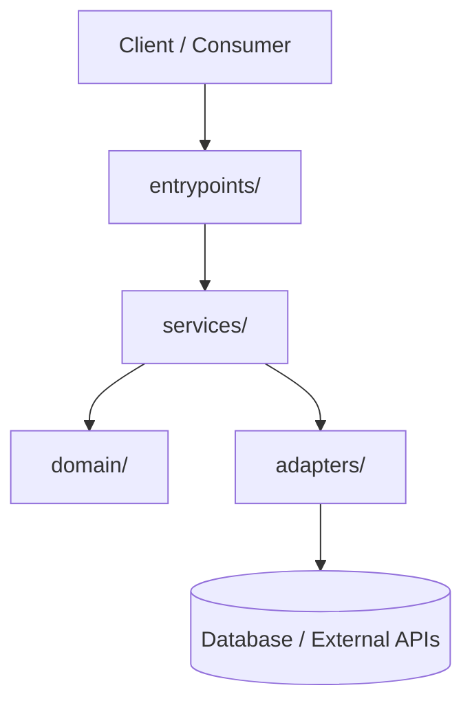

# Architecture Blueprint

This document defines the system architecture, directory boundaries, system topology, and technical stack. AI agents must consult this document before modifying system structure or introducing new components.

---

## 🏛️ System Overview & Boundaries

### 1. Overview
[Brief description of the system, primary components, runtime, and infrastructure boundaries.]

### 2. Tech Stack & Dependencies
- **Runtime & Language:** [e.g. Node 20+, Python 3.12+, .NET 8, etc.]
- **Frameworks & Libraries:** [Core frameworks]
- **Storage & Infrastructure:** [Databases, caches, message queues]

### 3. Layer Boundaries & Directory Map
```text
src/
├── domain/         # Pure business logic and domain entities (zero external dependencies)
├── services/       # Application services and anti-corruption wrappers
├── adapters/       # Persistence, external APIs, and transport handlers
└── entrypoints/    # CLI, HTTP controllers, or message consumers
```

### 4. Topology & Data Flow Diagram


---

## 🔒 Structural Invariants & Boundaries

1. **Dependency Direction:** Dependencies flow inward toward domain models. Domain logic must never import from `adapters/` or `entrypoints/`.
2. **Framework Seams:** Framework-specific annotations or transport decorators stay isolated in `entrypoints/` or `adapters/`.
3. **Engineering Standards:** For coding conventions, error handling, and design patterns (KISS, SRP, DIP, research when it pays, trade-offs), consult [ENGINEERING.md](./ENGINEERING.md).
